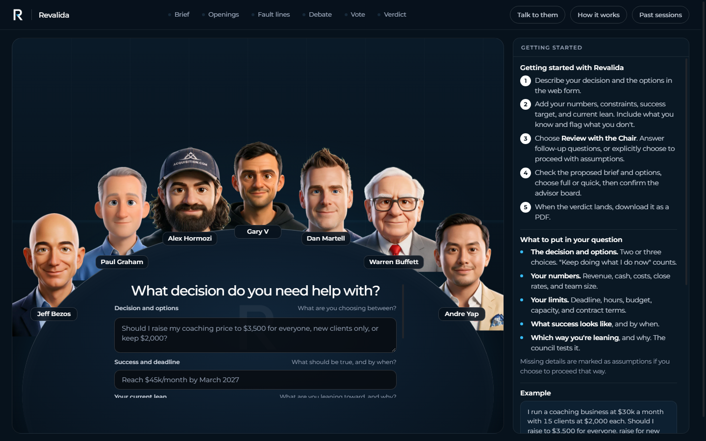

# Revalida: The AI Decision Council for Founders

Revalida helps founders, operators, and builders evaluate consequential business decisions—not simply validate ideas. Bring a dilemma and its real-world context to a live council of simulated advisors. Revalida clarifies decision-critical unknowns, prepares an intake brief for review, and waits for your explicit confirmation before the council convenes. The council debates the decision across rounds, produces a scored verdict with identified cruxes and dissent, saves a report, and exports an executive PDF summary.



---

## Background & Inspiration (100xOS R&D)

Revalida was developed as an open-source research and development exploration by **Alexis Valentino** while working with **100x** ([100xvc.io](https://100xvc.io) and their OS at [100xOS](https://app.100xvc.io/))—a VC-backed platform built as an AI operating system for builders and founders.

In high-growth startups and venture-backed ventures, founders make high-stakes, asymmetric decisions every single week:
- *Should we raise coaching prices 3x or switch to recurring SaaS?*
- *Should we hire an expensive VP of Sales or keep the founder closing deals?*
- *Should we accept a dilutive seed check with restrictive board terms?*

Traditional ideation tools just tell you "sounds great!" Revalida was born out of 100xOS R&D to do the exact opposite: **subject every crucial decision to rigorous, simulated boardroom scrutiny** with divergent mental models (first-principles engineering, ruthless capital allocation, high-velocity distribution, and operational discipline) before you commit capital, reputation, or engineering hours.

### 100% Open Source: Make It Your Own
Revalida is completely **open source** under the MIT license. Just as we repurposed and evolved this project, **you are encouraged to fork it, adapt it, and put your own spin on it**—add your own mentors, customize the scoring dimensions, or tailor it to your company's internal decision frameworks!

---

## Credits & How We Repurposed This

Proper credit and sincere appreciation go to **[Nate Herk](https://github.com/nateherkai)**, the original creator of **Roast Room**. Nate built an extraordinary foundation for simulating business mentors debating founder dilemmas.

### What Was There Before vs. Our Own Twist & Improvements
In the original implementation:
- Councils were primarily run through **OpenCode CLI sessions** or coding-agent chat loops, requiring users to drive the simulation through local agent commands.

In **Revalida**, we repurposed the project into a **standalone, web-first, API-native application** with several major improvements:

1. **Direct OpenAI API Architecture (`COUNCIL_RUNNER=api`)**:
   - Revalida communicates directly with OpenAI models (utilizing GPT-6 Luna structured outputs and streaming responses).
   - Anyone can run councils directly in their web browser with just an `OPENAI_API_KEY`—no external coding-agent environment required.
2. **Interactive Web Council Room with Real-Time Streaming**:
   - Built a real-time web application featuring Server-Sent Events (SSE) streaming for council rounds.
   - Animated visual speaking avatars synchronized with advisor turns and eye blinks.
   - **"Talk to them" Advisor Chat**: Founders can click on any advisor to engage in private, real-time 1-on-1 dialogue to probe their reasoning.
3. **Structured Intake & Dual-Mode Decision Council**:
   - **Guided Intake**: The Chair questions missing facts and assumptions *before* the council runs, preventing hallucinated conclusions.
   - **Explicit Confirmation Boundary**: No paid advisor rounds run until the founder reviews and approves the brief and council board.
   - **Full Mode (3 Rounds, 3–9 Advisors)** vs. **Quick Mode (2 Rounds + Tiebreaker Vote, 4 Advisors)** for agile decisions.
   - **Executive PDF Export**: Generates professional decision memos directly in the browser using client-side jsPDF.
4. **Expanded Advisor Roster**:
   - Expanded to **13 advisor seats**, including **Andre Yap** (focused on high-stakes consequential bets, market realities, and venture scale in emerging tech ecosystems).
5. **Runtime Security, Privacy & Quotas**:
   - Zero database overhead. Reports stay on your local disk (`sessions/`), and drafts remain in browser storage.
   - Built-in UTC daily IP-based sequence limits using salted HMAC-SHA256 digests (`app/.daily-limit.json`) to prevent API abuse.
6. **Dual Compatibility**:
   - Retains full support for both **Claude Code** (`.claude/`) and **OpenCode** (`.opencode/`) for developers who still enjoy running councils or building seats via AI coding agents.

---

## Security & Safe Public Deployment

Revalida is designed with strict data isolation so that you can safely clone, fork, and publish it:

- **Zero Secret Leaks**: The codebase has been audited end-to-end. No API keys, credentials, or personal tokens are tracked in git history or tracked repository files.
- **Protected Environment**: `.env` and `.env.*` are ignored by git (`!.env.example` is the only tracked template). Runtime keys remain strictly on your local machine.
- **Session Privacy**: Personal council deliberations generated in `sessions/` are ignored by git; only the bundled sanitized examples (`sessions/*example*`) ship with the repo.
- **Local-First Binding**: By default, the server binds to `127.0.0.1:4730`. It has no user authentication system.
- **Production Reverse Proxy**: If hosting publicly, deploy Revalida behind a TLS-terminating reverse proxy with access authentication. Set `TRUST_PROXY=true` only when the proxy reliably overwrites `X-Real-IP`, and set a unique, cryptographically random `DAILY_LIMIT_SECRET` in `.env`.

---

## Quickstart

### Prerequisites
- **Node.js**: v20.0.0 or higher
- **OpenAI API Key**: With billing enabled (GPT-6 Luna support)
- No package installations or build steps required! (Zero runtime npm dependencies beyond Node standard library).

### Installation & Run

```sh
# 1. Clone the repository
git clone https://github.com/alexisvalentino/revalida.git
cd revalida

# 2. Configure environment variables
cp .env.example .env
# Open .env and insert your OPENAI_API_KEY

# 3. Start the local server
npm start
```

Open your browser to: **[http://localhost:4730](http://localhost:4730)**

---

## Environment Variables

| Variable | Required | Default | Description |
|---|---|---|---|
| `OPENAI_API_KEY` | **Yes** | — | Powers council debates, intake questions, and 1-on-1 advisor chat. |
| `COUNCIL_RUNNER` | No | `api` | `api` runs councils live via OpenAI. `viewer` replays pre-saved sessions. |
| `CHAT_MAX_TOKENS` | No | `2500` | Max token limit for the "Talk to them" advisor chat. |
| `DAILY_LIMIT_SECRET` | No | derived from key | Secret key for hashing IP addresses in `app/.daily-limit.json`. |
| `TRUST_PROXY` | No | `false` | Set to `true` only when behind a trusted reverse proxy that sets `X-Real-IP`. |
| `KIE_AI_API_KEY` | Optional | — | Used only by maintainers generating animated 4-frame advisor avatars via [kie.ai](https://kie.ai). |

---

## How the Council Workflow Works

1. **Submit Dilemma**: Enter the core choice, known options (Option A, B, C), constraints, deadline, key metrics, and your current lean.
2. **Review with the Chair (Intake)**: The Chair identifies missing information that could materially flip the decision and asks brief clarifying questions.
3. **Refine Brief & Select Board**: Review the synthesized brief, select **Full Council** (3 rounds) or **Quick Council** (2 rounds), and confirm your advisor board.
4. **Explicit Confirmation**: Click **Confirm and start council**. (No paid advisor calls run before this step).
5. **Live Debate & Scoring**: Watch the advisors cross-examine each other's stances, surface hidden ruin risks, identify cruxes, and score each option.
6. **Verdict & PDF Export**: Review the weighted verdict, read dissenting perspectives, or export a cleanly formatted executive PDF memo.

---

## Guide: How to Add a Person / New Advisor

Want to add your mentor, a historical titan, or your company's founder to the council? Here is the complete end-to-end guide on building a custom advisor.

An advisor seat in Revalida consists of four elements:
1. **Knowledge Base (Brain)**: Markdown files in `.claude/skills/revalida/brains/<slug>/` containing verbatim, sourced stances and mental models.
2. **Agent Prompt**: System instructions in `.claude/agents/council-<key>.md` and `.opencode/agents/council-<key>.md`.
3. **Animated Avatar**: Four WebP frames (`base`, `open`, `mid`, `blink`) in `app/public/portraits/<key>-*.webp`.
4. **Roster Entry**: Registered in `.claude/skills/revalida/roster.json` and loaded by `app/lib/seats.mjs`.

### Step 1: Build the Knowledge Base (The Brain)
Create a directory: `.claude/skills/revalida/brains/<slug>/` (e.g. `brains/steve-jobs`).

A complete advisor brain contains the following markdown files:
- **`_hot.md`** (Executive Summary): Under 800 words. Summarizes their primary lens, 5–6 core questions they ask of any choice, their anchor biases, and *where their lens misfires* (when to ignore them).
- **`principles.md`**: 10–20 numbered, battle-tested operating principles with source citations.
- **`positions.md`**: Direct verbatim stances on foundational business dilemmas: pricing, hiring, firing, marketing, cash flow, debt, competition, and product speed.
- **`frameworks.md`**: Step-by-step diagnostic models they use (e.g., Bezos's "Type 1 vs. Type 2 decisions" or Musk's "5-step design process").
- **`stories.md`**: Defining real-world case studies and war stories from their career.
- **`voice.md`**: Speech cadence, vocabulary, rhetorical devices, and stylistic rules (e.g., "short, punchy sentences", "uses metaphors from physics").
- **`sources.md`**: Catalog of all public transcripts, essays, podcasts, and talks consulted, with source IDs (`S001`, `S002`, etc.) and URLs.

> **Tip:** You can use the automated builder workflow in `.claude/skills/advisor-builder/` or `.opencode/skills/advisor-builder/` with Claude Code or OpenCode to scrape, extract, and format these files automatically from public URLs.

### Step 2: Generate the 4-Frame Animated Avatar (using KIE.ai)
The Revalida web UI features animated avatars that move their mouths while talking and naturally blink while listening. Each advisor needs 4 WebP frames in `app/public/portraits/`:
- `<key>-base.webp`: Neutral resting face (eyes open, mouth closed)
- `<key>-open.webp`: Mouth wide open (speaking)
- `<key>-mid.webp`: Mouth slightly open (speaking transition)
- `<key>-blink.webp`: Eyes closed (natural blink)

#### Avatar Generation Steps:
1. **Obtain a KIE.ai Key**:
   - Sign up at [https://kie.ai](https://kie.ai/api-key) and get an API key.
   - Add it to your `.env` file:
     ```env
     KIE_AI_API_KEY=your_kie_key_here
     ```
2. **Install Image Processing Dependencies**:
   ```bash
   pip install opencv-python numpy
   ```
3. **Save a Clear Reference Photo**:
   - Pick a clear, front-facing, high-resolution portrait photograph of the person.
   - Save it into your build folder:
     ```bash
     node .claude/skills/advisor-builder/scripts/portrait.mjs photo build/<slug>/portrait <image-url-or-local-path>
     ```
4. **Generate Cartoon Portrait Candidates**:
   - Run the portrait script with a physical description (hair, glasses, clothing style):
     ```bash
     node .claude/skills/advisor-builder/scripts/portrait.mjs base build/<slug>/portrait "<Full Name>. Signature dark turtleneck, round wire glasses, trimmed stubble, friendly smirk."
     ```
5. **Generate Facial Expression & Talking Frames**:
   - The script creates the talking and blinking variations against a keyed background:
     ```bash
     node .claude/skills/advisor-builder/scripts/portrait.mjs frames build/<slug>/portrait
     ```
6. **Compile & Export WebP Frames**:
   - Crop, align, and output the final WebP files directly into `app/public/portraits/`:
     ```bash
     python .claude/skills/advisor-builder/scripts/build_portraits.py build build/<slug>/portrait <key> --out app/public/portraits
     ```

*(If you don't have a KIE.ai key, you can manually place 4 images or use the web app's built-in drawn placeholder bust).*

### Step 3: Register the Seat
1. Create `.claude/agents/council-<key>.md` and `.opencode/agents/council-<key>.md` containing the agent's persona prompt, referencing their brain files.
2. Register the advisor in `.claude/skills/revalida/roster.json`:
   ```json
   {
     "key": "jobs",
     "name": "Steve Jobs",
     "short": "Jobs",
     "slug": "steve-jobs",
     "pillar": "Product taste & focus",
     "question": "Does this strip away everything non-essential to create something insane?",
     "dimension": "Product excellence & differentiation"
   }
   ```
3. Add any natural board tensions in `.claude/skills/revalida/references/seats.md` (e.g. who they frequently argue with and why).
4. Run tests to confirm the seat loads cleanly:
   ```bash
   npm test
   ```

---

## Advisor Roster

Revalida includes thirteen battle-tested advisor seats:
- **Jeff Bezos** — Long-term customer obsession & irreversible one-way doors
- **Paul Graham** — Founder intuition, relentless launch speed & product truth
- **Alex Hormozi** — Grand slam offers, acquisition economics & margin leverage
- **Gary Vaynerchuk** — Consumer attention, brand relevance & day trading culture
- **Dan Martell** — Buy back your time, executive leverage & calendar audits
- **Andre Yap** — High-stakes consequential bets, macro realities & venture scale
- **Warren Buffett** — Capital preservation, durable moats & circular circle of competence
- **Sara Blakely** — Scrappy guerrilla sales, customer empathy & product necessity
- **Elon Musk** — First-principles engineering, physics limits & velocity
- **Naval Ravikant** — Permissionless leverage, specific knowledge & judgment
- **Gino Wickman** — EOS accountability, traction & process simplicity
- **Leila Hormozi** — Talent density, organizational systems & culture design
- **Peter Thiel** — Monopoly advantage, zero-to-one secrets & contrarian truths

---

## Development & Testing

Run unit and integration tests (mocked OpenAI calls, no API costs):
```bash
npm test
```

Run a live smoke test against OpenAI (incurs a small API cost):
```bash
npm run smoke
```

### Directory Structure
```
revalida/
├── app/
│   ├── lib/              # Council engine, OpenAI streaming, intake, limits, seats
│   ├── public/           # Front-end UI, SSE client, styles, portraits, brand marks
│   ├── scripts/          # Unit tests and smoke scripts
│   └── server.mjs        # Node.js HTTP server (zero external dependencies)
├── .claude/              # Claude Code advisor brains, agents, and builder skills
├── .opencode/            # OpenCode compatible agent and skill definitions
├── docs/                 # Documentation assets and screenshots
├── sessions/             # Runtime council reports & example sessions
├── .env.example          # Safe configuration template
└── README.md             # Project documentation
```

---

## License

This project is licensed under the [MIT License](LICENSE).

*Disclaimer: Advisor seats are simulated personas grounded in public research, interviews, and published works. They are not direct statements or endorsements from the individuals represented.*
